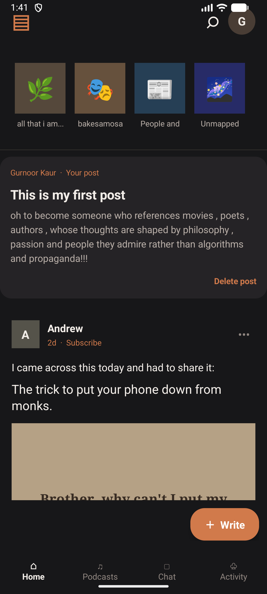
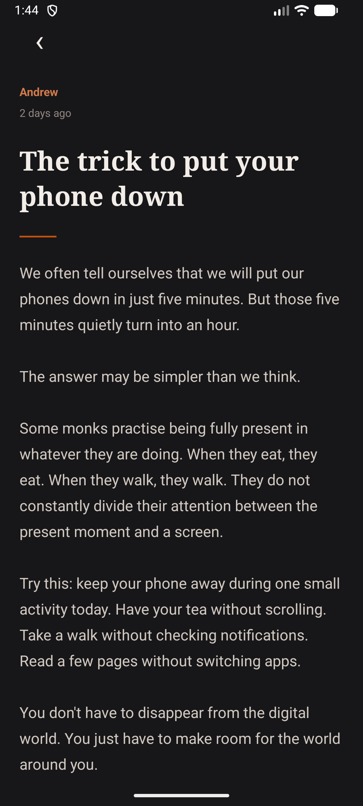
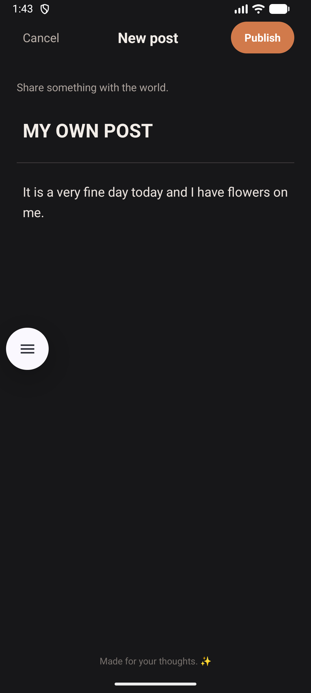
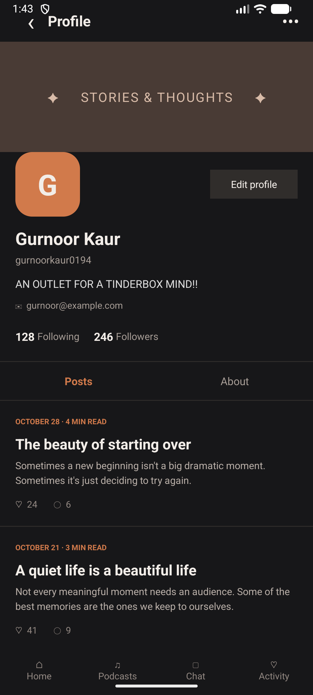
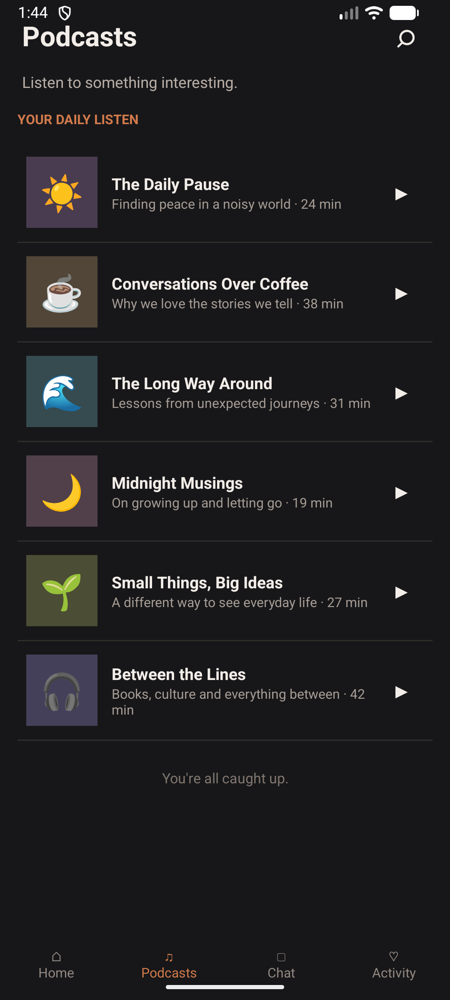
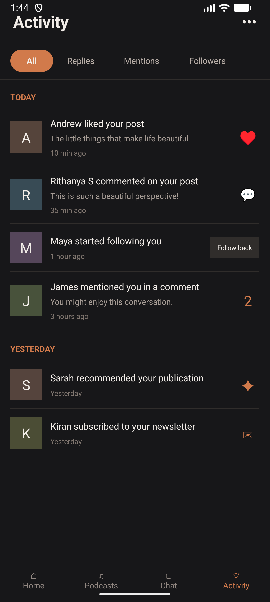
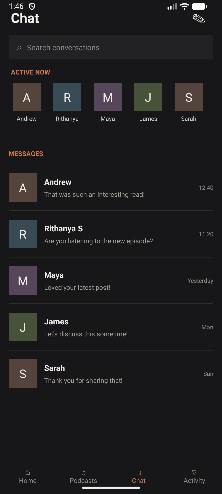
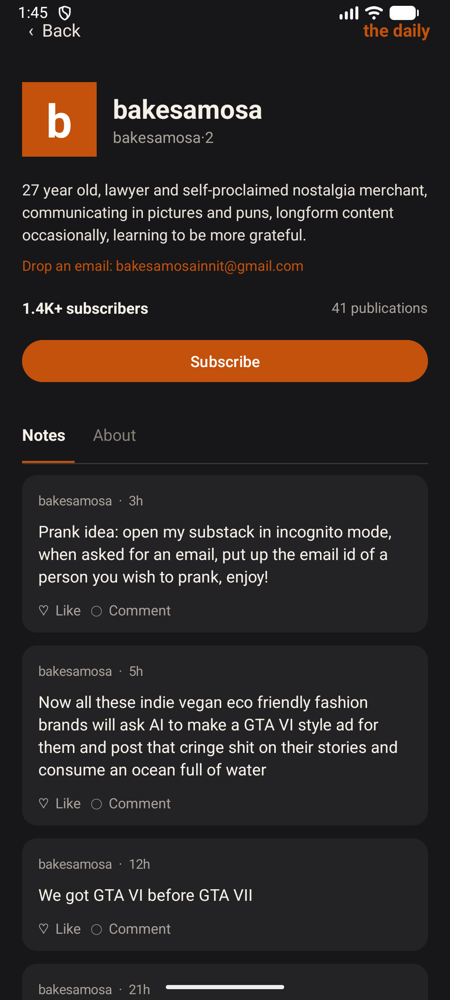

# YourStack

**A content-focused Android application for reading, writing, and sharing stories.**

YourStack is a Substack-inspired mobile application developed to provide a simple and intuitive platform for content discovery and publishing. It combines a clean reading interface with features that allow users to create posts, manage profiles, and explore different content sections.

## Features

- **Home Feed:** Browse and discover published posts.
- **Article Reading:** View individual posts through a dedicated reading interface.
- **Post Creation:** Write, publish, and delete posts.
- **User Profiles:** View and manage user profile information.
- **Profile Editing:** Update profile details.
- **Chat Interface:** Access the application's messaging interface.
- **Podcasts:** Explore the podcast section.
- **Splash Screen:** Custom application launch screen.

## Technology Stack

| Technology | Purpose |
|---|---|
| Java | Application development |
| XML | User interface design |
| Android Studio | Development environment |
| Gradle | Build automation |
| Android SDK | Android application development |

## Screenshots

<!-- Add screenshots of the application -->

| Home Feed |             Article Detail             |
|:---:|:--------------------------------------:|
|  |  |

|               Create Post               | User Profile |
|:---------------------------------------:|:---:|
|  |  |

|               Podcast page                |               Activity page                |
|:-----------------------------------------:|:------------------------------------------:|
|  |  |

|             Chat page              |             Subscribed author              |
|:----------------------------------:|:------------------------------------------:|
|  |  |

## Project Structure

```text
YourStack/
├── app/
│   └── src/
│       └── main/
│           ├── java/
│           ├── res/
│           │   ├── drawable/
│           │   ├── layout/
│           │   ├── mipmap/
│           │   └── values/
│           └── AndroidManifest.xml
├── gradle/
├── build.gradle.kts
├── settings.gradle.kts
└── README.md
```

## Getting Started

### Prerequisites

- Android Studio
- Android SDK
- Java Development Kit (JDK)

### Installation

1. Clone the repository:

   ```bash
   git clone https://github.com/YOUR-USERNAME/YourStack.git
   ```

2. Open the project in Android Studio.

3. Allow Gradle to sync and download the required dependencies.

4. Launch an Android emulator or connect an Android device.

5. Build and run the application.

## Project Objective

YourStack was developed as an exploration of Android application development, focusing on UI design, activity navigation, and content publishing workflows using Java and XML.

## Contributing

Contributions, suggestions, and improvements are welcome. Feel free to fork the repository and submit a pull request.

## License

No license has been specified for this project yet.